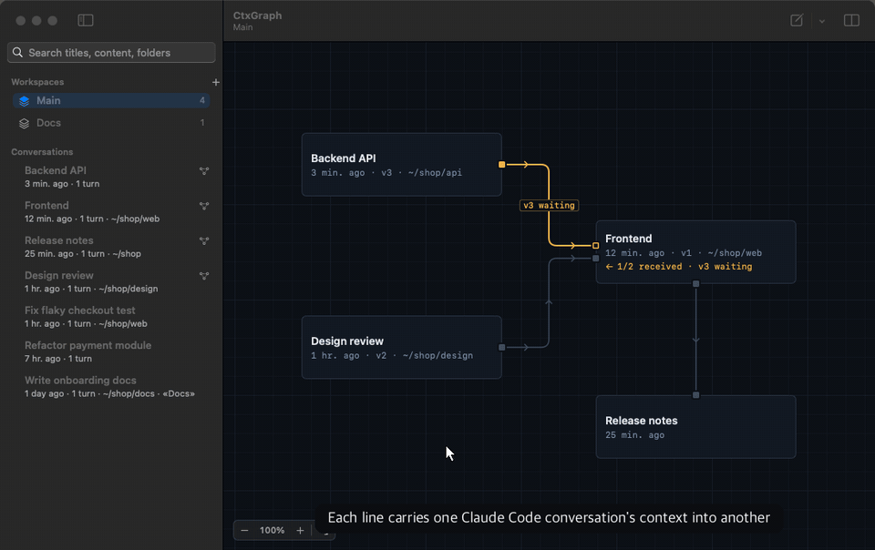
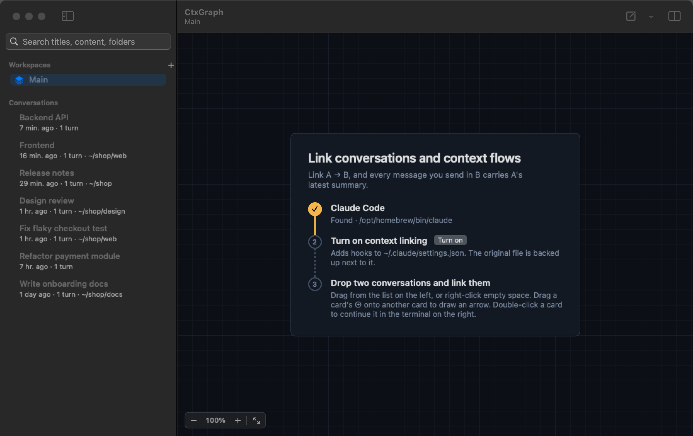
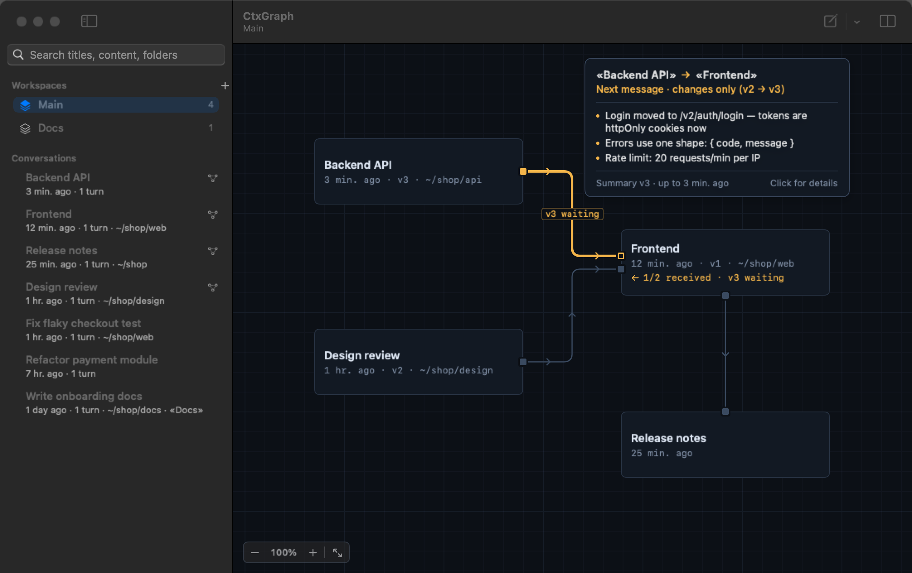

<p align="center"></p>

<h1 align="center">CtxGraph</h1>

<p align="center"><b>Claude Code の会話どうしを線でつなぐ Mac アプリ</b><br>
A から B へ矢印を引くと、B で送るメッセージごとに A の最新の要約が一緒に届きます。</p>

<p align="center">macOS 14 以降 · 無料・オープンソース (MIT) · ローカルで動作、サーバー不要<br>
<a href="README.md">English</a> · <a href="README.ko.md">한국어</a> · 日本語 · <a href="README.zh-CN.md">简体中文</a></p>

> アプリの表示言語は英語と韓国語です（macOS の言語設定が韓国語なら韓国語、それ以外は英語）。日本語 UI はまだありません。

---

バックエンド用、フロントエンド用、デザインレビュー用と Claude Code の会話を分けて作業していると、別のウィンドウで決めたことを何度も説明し直すことになります。CtxGraph はそうした会話をグラフにしてつなぎます。

- **A → B** — B でメッセージを送ると、Claude は A の最新の要約も受け取ります（初回は全文、以降は変わった部分だけ）。
- **A ⇄ B** — 双方向にコンテキストを共有します。
- 線を見るだけで、A で決めたことを B がもう知っているかがわかります。B 側のピンが塗りつぶされていれば最新、黄色い線なら新しい要約が待機中です。

ターミナルを内蔵したネイティブ Mac アプリなので、グラフの隣でどの会話でも開いてそのまま作業を続けられます。

## 仕組み

```
 会話 A ──(ターン終了)──▶ Haiku の要約 v3 ──(B で次のメッセージを送る)──▶ 会話 B
     Stop フック: 要約を予約          UserPromptSubmit フック: 追加コンテキストとして注入
```

1. CtxGraph は `~/.claude/settings.json` に [Claude Code のフック](https://docs.claude.com/en/docs/claude-code/hooks)をいくつか追加します（追加する前に元のファイルをバックアップし、ほかのフックには触れません）。
2. コンテキストを**送る**会話のターンが終わると、バックグラウンドのジョブが 20 秒間動きがなくなるのを待ち（前回の要約から最低 2 分）、**Claude Haiku** で要約を更新します。使うのはあなた自身の Claude Code のログイン（`claude -p`）で、新しく増えたメッセージだけを反映します。
3. コンテキストを**受け取る**会話でメッセージを送ると、フックがまだ受け取っていない要約を追加コンテキストとして加えます。初回は要約の全文、以降は差分だけです。チャット画面には何も表示されず、Claude だけが知っている状態になります。

どこにも送らない会話は要約されません。サーバーもありません。アプリとフックが 1 つの SQLite ファイルを共有します。

## インストール

**必要なもの:** macOS 14 以降、[Claude Code](https://claude.com/claude-code)、Python 3.9 以降（macOS の開発者ツールに入っている `python3` で十分です。なければアプリがインストールを案内します）。

**方法 1 — ダウンロード。** [Releases](https://github.com/groothaha/ctx-graph/releases) から `CtxGraph-<バージョン>.zip` をダウンロードして展開し、`CtxGraph.app` を「アプリケーション」フォルダに移動します。
CtxGraph は **Apple の公証を受けていません**（有料の開発者アカウントが必要なため）。そのため初回は macOS が開くのを拒否します。**システム設定 → プライバシーとセキュリティ** を下までスクロールして **このまま開く** をクリックするか、次を実行してください。

```sh
xattr -dr com.apple.quarantine /Applications/CtxGraph.app
```

**方法 2 — Homebrew。** 中身は同じアプリなので、初回起動時の手順も同じです。

```sh
brew install --cask groothaha/tap/ctxgraph
```

**方法 3 — ソースからビルド**（Gatekeeper の確認なし。Xcode Command Line Tools が必要、1 分ほど）:

```sh
git clone https://github.com/groothaha/ctx-graph && cd ctx-graph
./build.sh            # → ~/Applications/CtxGraph.app
```

`build.sh` はまず必要なもの（macOS 14 以降、Command Line Tools、Swift 5.9 以降、Python、Claude Code）を確認し、Command Line Tools がなければインストールするか尋ねます。確認だけなら `./build.sh --check`。それでもビルドできないときは [DEVELOPMENT.md の Building](docs/DEVELOPMENT.md#building)（英語）を見てください。

## 初回起動



空のグラフが 3 つのステップを案内します。`claude` を見つけ、**Turn on context linking**（フックのインストール。Settings → Claude Code でいつでもオフにできます）を勧め、最後に左のサイドバーから会話を 2 つキャンバスにドラッグします。

## 使い方



- **会話を追加** — サイドバーからドラッグするか、キャンバスの空いた所を右クリック → *Add Conversation Here*。
- **つなぐ** — カードの ⊕ を別のカードにドラッグします（カードから右ドラッグでも可）。逆向きにもドラッグすると ⇄ になります。矢印をクリックすると、両端を付け替えたり、向きを反転したり、削除したりできます。
- **線の読み方** — 線上の山形（›）がコンテキストの流れる向きです。灰色の線で受け取り側のピンが塗りつぶされていれば*最新まで受け取り済み*、黄色い線で中空のピンなら新しい要約が受け取り側の次のメッセージを待っています。破線は要約の予約中・作成中、赤は失敗です。
- **ホバーで確認** — 矢印にマウスを乗せると、次に流れる内容（または前回届いた内容）がそのまま表示されます。
- **プレビュー** — 受け取る会話のインスペクタに、次のメッセージに実際に入るテキストが表示されます。
- **作業を続ける** — カードをダブルクリックすると、右側のターミナルでその会話を再開します（`claude --resume`）。タブ、分割（⌘D）、縦型のタブ一覧があり、アプリを終了してもターミナルは動き続けます。
- **ワークスペース** — グラフとターミナルの配置を複数に分けられます（⌘1…9）。同じ会話を複数のワークスペースに置け、ワークスペースをまたいでつなぐこともできます。
- **Claude Code の中から** — `/ctx` と入力します（アプリがこのスキルをインストールします）。`/ctx from <名前>` でほかの会話のコンテキストを取り込み、`/ctx to <名前>` でこの会話のコンテキストを送り、`/ctx link <名前>` で双方向に共有します。

詳しくは[ガイド](docs/GUIDE.md)（英語）へ。矢印の状態、ターミナル、ワークスペース、モデル、キーボードショートカットを説明しています。

## プライバシーとコスト

- すべてあなたの Mac の中に残ります。会話の記録は `~/.claude/projects` から読み、グラフは `~/Library/Application Support/CtxGraph/` に保存されます。テレメトリもアカウントもありません。
- 外部に送られるのは要約のリクエストだけで、あなた自身の Claude Code のログインで Anthropic に送られます。そのため **Claude Code の使用量に含まれます**（Settings → Claude Code で今日・今週の要約回数を確認できます）。要約モデルを API キー（Anthropic、OpenRouter、Anthropic 互換のエンドポイント）に切り替えることもできます。
- 要約されるのは出ていく矢印がある会話だけで、それも新しいメッセージだけです。
- アプリ内ターミナルの Claude Code は、通常どおり権限の確認を求めます。*Run Claude without permission prompts*（`--dangerously-skip-permissions`）は Settings → Terminal で自分でオンにした場合だけ有効です。

## オフにする

Settings → Claude Code → **Turn off (remove hooks)**、または `python3 -I ~/Library/Application\ Support/CtxGraph/bin/ctxgraph.py uninstall-hooks`。削除されるのは CtxGraph のフックだけで、ほかのフックや設定はそのままです。すべて消すには `~/Library/Application Support/CtxGraph` も削除してください。

## よくある質問

**Codex、Gemini CLI、Cursor でも使えますか？** いいえ。CtxGraph は Claude Code 専用です（フック、会話の記録、`--resume` を使います）。OpenRouter や Anthropic 互換 API のモデルは Claude Code の中で動くので使えます。

**なぜ MCP サーバーではなくフックなのですか？** フックはメッセージごとに自動でコンテキストを注入します。ツールにすると、呼ぶかどうかを Claude が判断することになります。

**Claude Code が遅くなりませんか？** グラフにない会話では、フックは 45 ms ほどで終わります。要約はターンが終わった後にバックグラウンドで実行されます。

**Windows や Linux は？** 今のところ対応していません。SwiftUI の Mac アプリです。

## ドキュメント

- [ガイド](docs/GUIDE.md) — アプリの機能すべてとショートカット（英語）
- [開発](docs/DEVELOPMENT.md) — 構成、ビルド、テスト、隔離したテスト環境、翻訳、リリース（英語）

## ライセンス

MIT — [LICENSE](LICENSE) を参照。[SwiftTerm](https://github.com/migueldeicaza/SwiftTerm)（MIT）と [D2Coding](https://github.com/naver/d2codingfont) フォント（SIL OFL 1.1）を含みます。[THIRD_PARTY_NOTICES.md](THIRD_PARTY_NOTICES.md) を参照してください。
