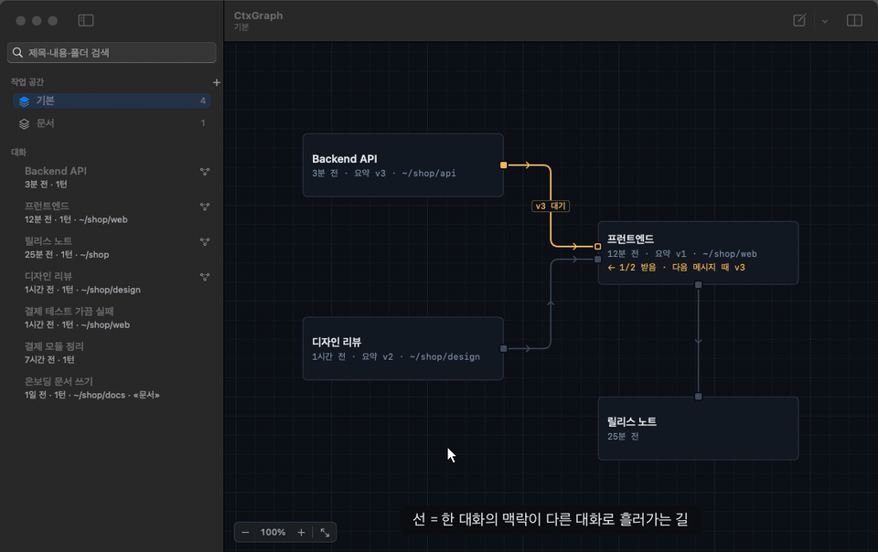
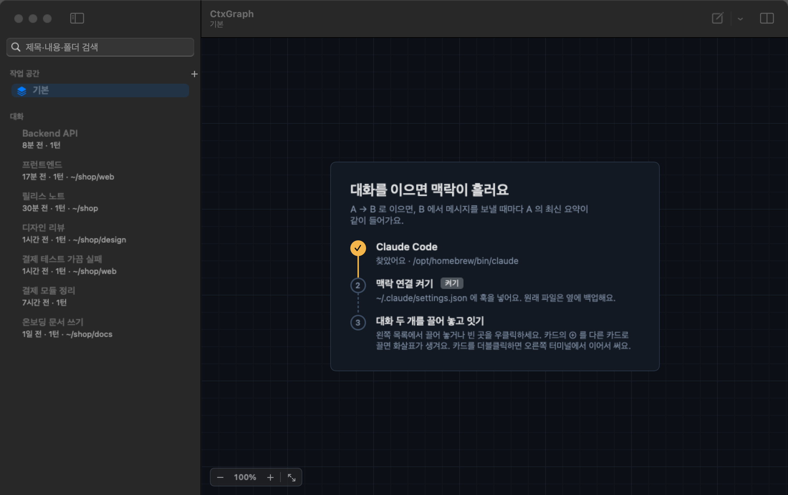
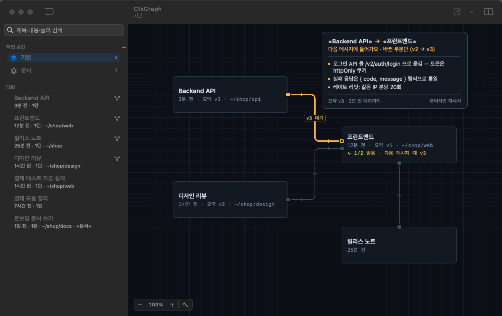

<p align="center"></p>

<h1 align="center">CtxGraph</h1>

<p align="center"><b>Claude Code 대화끼리 맥락을 이어 주는 맥 앱</b><br>
A 에서 B 로 화살표를 그으면, B 에서 보내는 메시지마다 A 의 최신 요약이 같이 들어가요.</p>

<p align="center"><b>맥 전용</b> (macOS 14 이상) · 무료 오픈소스 (MIT) · 내 맥에서만 동작, 서버 없음<br>
<a href="README.md">English</a> · 한국어 · <a href="README.ja.md">日本語</a> · <a href="README.zh-CN.md">简体中文</a></p>

---

일을 여러 Claude Code 대화로 나눠 하다 보면(백엔드 하나, 프런트엔드 하나, 디자인 리뷰 하나) 다른 창에서 정한 걸 또 설명하느라 시간을 써요. CtxGraph 는 그 대화들을 그래프로 이어요.

- **A → B** — B 에서 메시지를 보내면 Claude 가 A 의 최신 요약도 같이 받아요 (처음엔 전체, 그다음부턴 바뀐 부분만).
- **A ⇄ B** — 서로 맥락을 나눠요.
- 선만 봐도 A 에서 방금 정한 걸 B 가 이미 아는지 보여요: B 쪽 핀이 채워져 있으면 최신, 노란 선이면 새 요약이 기다리는 중.

터미널이 들어 있는 맥 앱이라, 그래프 옆에서 아무 대화나 열어 이어서 작업할 수 있어요.

## 어떻게 동작하나요

```
 대화 A ──(턴이 끝나면)──▶ Haiku 요약 v3 ──(B 에서 다음 메시지를 보낼 때)──▶ 대화 B
     Stop 훅: 요약 예약                  UserPromptSubmit 훅: 추가 맥락으로 넣기
```

1. CtxGraph 가 `~/.claude/settings.json` 에 [Claude Code 훅](https://docs.claude.com/en/docs/claude-code/hooks) 몇 개를 넣어요 (넣기 전에 원래 파일을 백업하고, 다른 훅은 건드리지 않아요).
2. 맥락을 **보내는** 대화의 턴이 끝나면, 20초 동안 잠잠하고 이전 요약에서 2분이 지난 뒤 **Claude Haiku** 로 요약을 새로 만들어요 — 내 Claude Code 로그인(`claude -p`)으로, 새로 붙은 메시지만 반영해서요.
3. 맥락을 **받는** 대화에서 메시지를 보내면, 훅이 아직 안 받은 요약을 추가 맥락으로 넣어요: 처음엔 전체 요약, 그다음부턴 바뀐 부분만. 대화 화면엔 아무것도 안 보이고 Claude 만 알게 돼요.

어디로도 보내지 않는 대화는 요약하지 않아요. 서버도 없어요: 앱과 훅이 SQLite 파일 하나를 같이 써요.

## 설치

**필요한 것:** macOS 14 이상인 맥 (윈도우·리눅스용은 없어요), [Claude Code](https://claude.com/claude-code), Python 3.9 이상 (맥 개발자 도구에 들어 있는 `python3` 면 충분해요 — 없으면 앱이 설치를 안내해요).

**방법 1 — 내려받기.** [Releases](https://github.com/groothaha/ctx-graph/releases) 에서 `CtxGraph-<버전>.zip` 을 받아 풀고 `CtxGraph.app` 을 응용 프로그램 폴더로 옮겨요.
CtxGraph 는 **애플 공증을 받지 않았어요** (유료 개발자 계정이 필요해서요). 그래서 처음엔 macOS 가 열기를 막아요. **시스템 설정 → 개인정보 보호 및 보안** 에서 아래로 내려 **그래도 열기** 를 누르거나, 터미널에서:

```sh
xattr -dr com.apple.quarantine /Applications/CtxGraph.app
```

**방법 2 — Homebrew.** 같은 앱이라 처음 열 때 같은 단계가 필요해요:

```sh
brew install --cask groothaha/tap/ctxgraph
```

**방법 3 — 소스에서 빌드** (위 단계 없음, 1분쯤). 권장: **Xcode** — [`.xcode-version`](.xcode-version) 에 적힌 버전이 CI 가 빌드하는 버전이고, Xcode 15 이상이면 대개 돼요. Command Line Tools 만 있어도 빌드돼요.

```sh
git clone https://github.com/groothaha/ctx-graph && cd ctx-graph
./build.sh            # → ~/Applications/CtxGraph.app
```

`build.sh` 는 먼저 필요한 것(macOS 14 이상, Command Line Tools, Swift 5.9 이상, Python, Claude Code)을 확인하고, 개발자 도구가 없으면 설치 창을 띄울지 물어봐요. 확인만 하려면 `./build.sh --check`. 빌드가 안 되면(예: 최신 SDK 가 쓰는 플러그인이 Command Line Tools 에 없을 때) 설치된 Xcode 와 이전 SDK 로 다시 해 보고, 그래도 안 되면 미리 빌드된 앱을 대신 설치할지 물어봐요 (`./build.sh --prebuilt` 는 바로 설치). 자세한 건 [Building](docs/DEVELOPMENT.md#building) (영어).

## 처음 켜면



빈 그래프가 세 단계를 안내해요: `claude` 를 찾고, **맥락 연결 켜기** (훅 설치 — 설정 → Claude Code 에서 언제든 끌 수 있어요), 그리고 왼쪽 목록에서 대화 두 개를 끌어다 놓기.

## 쓰는 법



- **대화 추가** — 사이드바에서 끌어 놓거나, 빈 곳 우클릭 → *여기에 대화 추가*.
- **잇기** — 카드의 ⊕ 를 다른 카드로 끌어요 (카드에서 오른쪽 버튼으로 끌어도 돼요). 반대로도 끌면 ⇄. 화살표를 누르면 양끝을 다른 카드로 옮기거나, 방향을 뒤집거나, 끊을 수 있어요.
- **선 읽기** — 선 위 꺾쇠가 맥락이 흐르는 방향이에요. 회색 선에 받는 핀이 채워져 있으면 *최신까지 받음*, 노란 선에 빈 핀이면 새 요약이 다음 메시지를 기다리는 중. 점선은 요약 예약·요약 중, 빨간 점선은 실패예요.
- **엿보기** — 화살표에 마우스를 올리면 다음에 흘러갈 내용(또는 마지막으로 들어간 내용)이 보여요.
- **미리보기** — 받는 대화의 인스펙터에서 다음 메시지에 실제로 들어갈 글을 그대로 볼 수 있어요.
- **이어서 작업** — 카드를 더블클릭하면 오른쪽 터미널에서 그 대화를 이어서 써요 (`claude --resume`). 탭·분할(⌘D)·세로 탭이 있고, 앱을 꺼도 터미널은 계속 돌아요.
- **작업 공간** — 그래프와 터미널 배치를 여러 벌로 나눠요 (⌘1…9). 같은 대화를 여러 공간에 둘 수 있고, 공간을 넘어서도 이을 수 있어요.
- **Claude Code 안에서** — `/ctx` (앱이 넣어 주는 스킬): `/ctx from <이름>` 다른 대화의 맥락 받아오기, `/ctx to <이름>` 이 대화 맥락 보내기, `/ctx link <이름>` 서로 나누기.

더 자세한 건 [안내서](docs/GUIDE.md) (영어) — 화살표 상태, 터미널, 작업 공간, 모델, 단축키.

## 개인정보와 비용

- 모든 게 내 맥에 남아요: 대화 기록은 `~/.claude/projects` 에서 읽고, 그래프는 `~/Library/Application Support/CtxGraph/` 에 있어요. 원격 수집도, 계정도 없어요.
- 밖으로 나가는 건 요약 요청뿐이고, 내 Claude Code 로그인으로 Anthropic 에 가요 — 그래서 **Claude Code 사용량에 포함돼요** (설정 → Claude Code 에서 오늘·이번 주 요약 횟수를 볼 수 있어요). 요약 모델을 API 키(Anthropic, OpenRouter, Anthropic 호환 주소)로 바꿀 수도 있어요.
- 나가는 화살표가 있는 대화만, 새로 붙은 메시지만 요약해요.
- 앱 터미널의 Claude Code 는 평소처럼 권한을 물어봐요. *권한 확인 없이 실행* (`--dangerously-skip-permissions`) 은 설정 → 터미널에서 직접 켜야 해요.
- 한국어 화면에선 터미널 글꼴이 D2Coding 이라 한글이 벌어지지 않아요 (설정 → 터미널에서 SF Mono 로 바꿀 수 있어요).

## 끄기

설정 → Claude Code → **끄기 (훅 빼기)**, 또는 `python3 -I ~/Library/Application\ Support/CtxGraph/bin/ctxgraph.py uninstall-hooks`. CtxGraph 의 훅만 빠지고 다른 훅·설정은 그대로예요. 전부 지우려면 `~/Library/Application Support/CtxGraph` 도 지우세요.

## 자주 묻는 것

**Codex, Gemini CLI, Cursor 도 되나요?** 아니요 — Claude Code 전용이에요 (훅·대화 기록·`--resume` 을 써요). OpenRouter 나 Anthropic 호환 API 의 모델은 Claude Code 안에서 돌기 때문에 돼요.

**왜 MCP 서버가 아니라 훅인가요?** 훅은 메시지마다 맥락을 자동으로 넣어요. 도구로 만들면 Claude 가 부를지 말지 정해야 해요.

**Claude Code 가 느려지나요?** 그래프에 없는 대화에선 훅이 45ms 쯤 만에 끝나요. 요약은 턴이 끝난 뒤 뒤에서 돌아요.

**윈도우·리눅스는요?** 지금은 안 돼요 — SwiftUI 맥 앱이에요.

## 문서

- [안내서](docs/GUIDE.md) — 앱 기능 전체와 단축키 (영어)
- [개발](docs/DEVELOPMENT.md) — 구조, 빌드, 테스트, 격리된 시험 환경, 번역, 배포 (영어)

## 라이선스

MIT — [LICENSE](LICENSE). [SwiftTerm](https://github.com/migueldeicaza/SwiftTerm) (MIT) 과 [D2Coding](https://github.com/naver/d2codingfont) 글꼴 (SIL OFL 1.1) 이 들어 있어요. [THIRD_PARTY_NOTICES.md](THIRD_PARTY_NOTICES.md) 참고.
