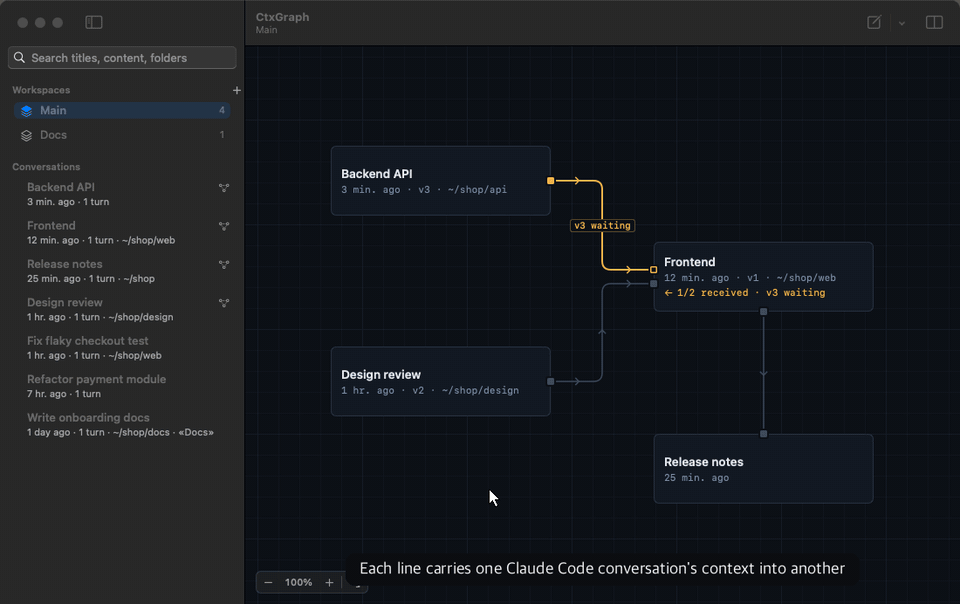
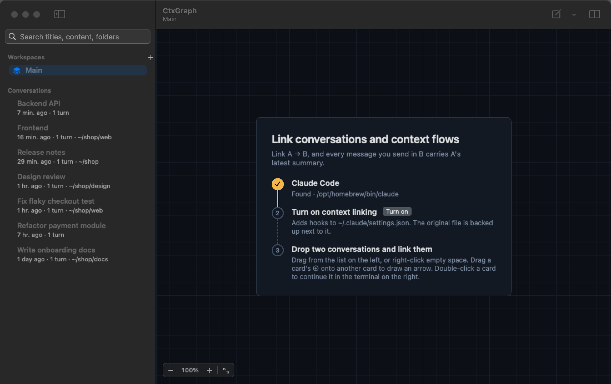
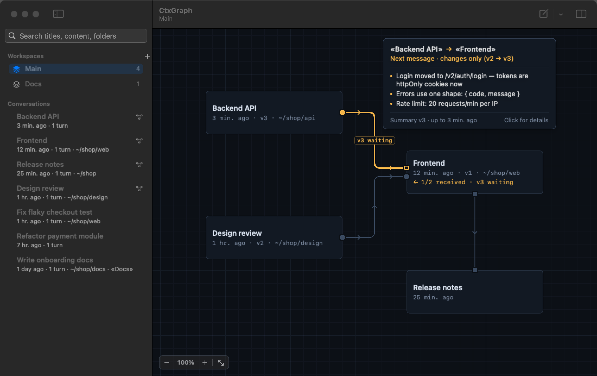

<p align="center"></p>

<h1 align="center">CtxGraph</h1>

<p align="center"><b>A Mac app that wires your Claude Code conversations together.</b><br>
Draw an arrow from A to B, and every message you send in B carries A's latest summary.</p>

<p align="center"><b>macOS only</b> (14+) · free & open source (MIT) · runs locally, no server<br>
English · <a href="README.ko.md">한국어</a> · <a href="README.ja.md">日本語</a> · <a href="README.zh-CN.md">简体中文</a></p>

---

You split work across Claude Code conversations — one for the backend, one for the frontend, one for the design review — and then spend your time re-explaining what was decided in the other window. CtxGraph turns those conversations into a graph:

- **A → B** — when you send a message in B, Claude also gets A's latest summary (the first time in full, afterwards only what changed).
- **A ⇄ B** — they share context both ways.
- Each line shows at a glance whether B already knows what A just decided: a filled pin where it enters B means up to date, a yellow line means a new summary is waiting.

It is a native Mac app with built-in terminals, so you can open any conversation next to the graph and keep working.

## How it works

```
 conversation A ──(turn ends)──▶ Haiku summary v3 ──(your next message in B)──▶ conversation B
        Stop hook: schedule              UserPromptSubmit hook: inject as extra context
```

1. CtxGraph adds a few [Claude Code hooks](https://docs.claude.com/en/docs/claude-code/hooks) to `~/.claude/settings.json` (it backs the file up first and never touches your other hooks).
2. When a conversation that **sends** context finishes a turn, a background job waits until it has been quiet for 20 s (and at least 2 min since the last summary), then updates its summary with **Claude Haiku** — through your own Claude Code login (`claude -p`), folding in only the new messages.
3. When you send a message in a **receiving** conversation, the hook adds the summaries it hasn't seen yet as extra context: the full summary the first time, then just the delta. Nothing shows up in your chat; Claude simply knows.

Conversations that don't send anywhere are never summarized. There is no server: the app and the hooks share one SQLite file.

## Install

**Requirements:** a Mac with macOS 14 or later (there is no Windows or Linux version), [Claude Code](https://claude.com/claude-code), and Python 3.9+ (the `python3` that comes with the macOS developer tools is enough — the app offers to install them if missing).

**Option 1 — download.** Get `CtxGraph-<version>.zip` from [Releases](https://github.com/groothaha/ctx-graph/releases), unzip, and move `CtxGraph.app` to Applications.
CtxGraph is **not notarized** (that needs a paid Apple developer account), so the first time macOS will refuse to open it. Open **System Settings → Privacy & Security**, scroll down, and click **Open Anyway** — or run:

```sh
xattr -dr com.apple.quarantine /Applications/CtxGraph.app
```

**Option 2 — Homebrew.** Same app, same first-launch step:

```sh
brew install --cask groothaha/tap/ctxgraph
```

**Option 3 — build from source** (no Gatekeeper prompt, ~1 min). Recommended: **Xcode** — the version in [`.xcode-version`](.xcode-version) is the one CI builds with; any Xcode 15 or later usually works. The Command Line Tools alone also work.

```sh
git clone https://github.com/groothaha/ctx-graph && cd ctx-graph
./build.sh            # → ~/Applications/CtxGraph.app
```

`build.sh` first checks what it needs (macOS 14+, the Command Line Tools, Swift 5.9+, Python, Claude Code) and offers to install the Command Line Tools if they are missing; `./build.sh --check` runs only that check. If it can't build — for example the Command Line Tools lack a plugin that the newest SDK needs — it tries your installed Xcode and older SDKs, and finally offers to install the prebuilt release instead (`./build.sh --prebuilt` does that directly). Details: [Building](docs/DEVELOPMENT.md#building).

## First run



The empty graph walks you through three steps: it finds `claude`, offers to **turn on context linking** (installs the hooks — you can turn them off any time in Settings → Claude Code), and then you drag two conversations from the sidebar onto the canvas.

## Using it



- **Add conversations** — drag them from the sidebar, or right-click empty canvas → *Add Conversation Here*.
- **Link them** — drag the ⊕ on a card onto another card (or right-drag from a card). Drag back the other way for ⇄. Click an arrow to re-attach either end, flip it, or remove it.
- **Read the lines** — chevrons along each line point the way context flows. A grey line with a filled pin at the receiving end means *up to date*; a yellow line with a hollow pin means a new summary is waiting for the receiver's next message. Dashes mean a summary is scheduled or being written; red means it failed.
- **Peek** — hover an arrow to see exactly what will flow next (or what went in last).
- **Preview** — the inspector of a receiving conversation shows the exact text its next message will carry.
- **Keep working** — double-click a card to continue that conversation (`claude --resume`) in the terminal on the right. Tabs, splits (⌘D) and a vertical tab list are built in, and terminals keep running when you quit the app.
- **Workspaces** — keep separate graphs and terminal layouts (⌘1…9). The same conversation can sit in several workspaces, and arrows cross workspaces.
- **From inside Claude Code** — type `/ctx` (the app installs this skill): `/ctx from <name>` pulls another conversation's context in, `/ctx to <name>` sends this one's out, `/ctx link <name>` shares both ways.

More in the [guide](docs/GUIDE.md) — arrow states, terminals, workspaces, models and keyboard shortcuts.

## Privacy and cost

- Everything stays on your Mac: transcripts are read from `~/.claude/projects`, the graph lives in `~/Library/Application Support/CtxGraph/`. No telemetry, no account.
- The only thing sent anywhere is the summary request, which goes to Anthropic through your own Claude Code login — so it **counts toward your Claude Code usage** (Settings → Claude Code shows how many summaries ran today / this week). You can switch the summary model to an API key (Anthropic, OpenRouter or any Anthropic-compatible endpoint) instead.
- Only conversations with an outgoing arrow are ever summarized, and only their new messages.
- In-app terminals start Claude Code with its normal permission prompts. *Run Claude without permission prompts* (`--dangerously-skip-permissions`) is an opt-in in Settings → Terminal.

## Turning it off

Settings → Claude Code → **Turn off (remove hooks)**, or `python3 -I ~/Library/Application\ Support/CtxGraph/bin/ctxgraph.py uninstall-hooks`. Only CtxGraph's hooks are removed; your other hooks and settings stay. To remove everything, also delete `~/Library/Application Support/CtxGraph`.

## FAQ

**Does it work with Codex, Gemini CLI or Cursor?** No — CtxGraph is built for Claude Code (its hooks, transcripts and `--resume`). Models from OpenRouter or other Anthropic-compatible APIs work, because they run inside Claude Code.

**Why hooks and not an MCP server?** A hook injects the context automatically on every message; with a tool, Claude would have to decide to call it.

**Does it slow Claude Code down?** For conversations that aren't in the graph the hook exits in about 45 ms. Summaries run in the background after a turn ends.

**Windows / Linux?** Not at the moment — CtxGraph is a macOS-only SwiftUI app.

## Documentation

- [Guide](docs/GUIDE.md) — everything the app does, with shortcuts
- [Development](docs/DEVELOPMENT.md) — architecture, building, tests, the isolated test harness, localization, releasing

## License

MIT — see [LICENSE](LICENSE). Includes [SwiftTerm](https://github.com/migueldeicaza/SwiftTerm) (MIT) and the [D2Coding](https://github.com/naver/d2codingfont) font (SIL OFL 1.1); see [THIRD_PARTY_NOTICES.md](THIRD_PARTY_NOTICES.md).
