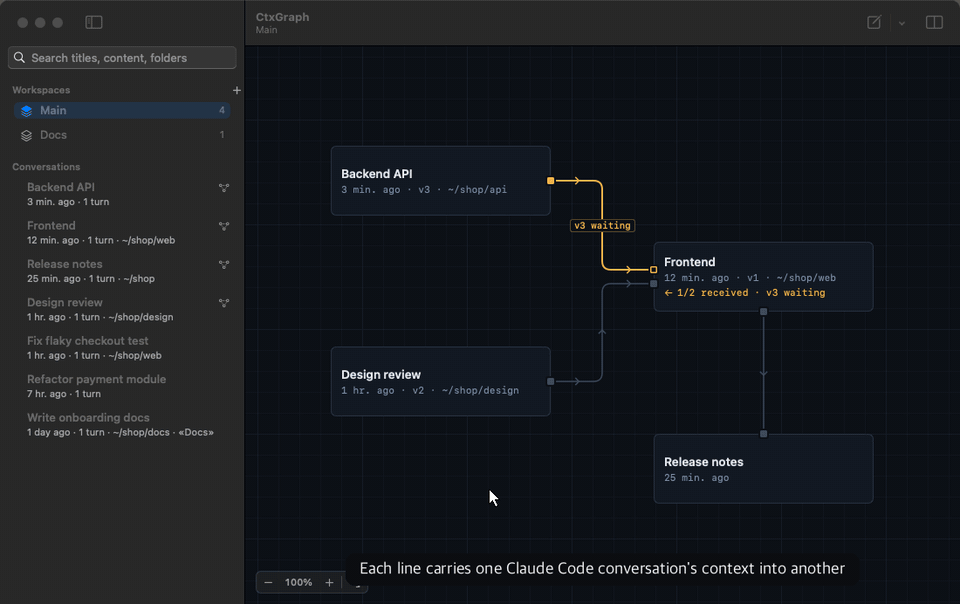
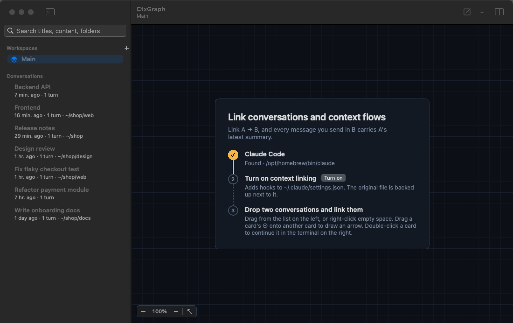
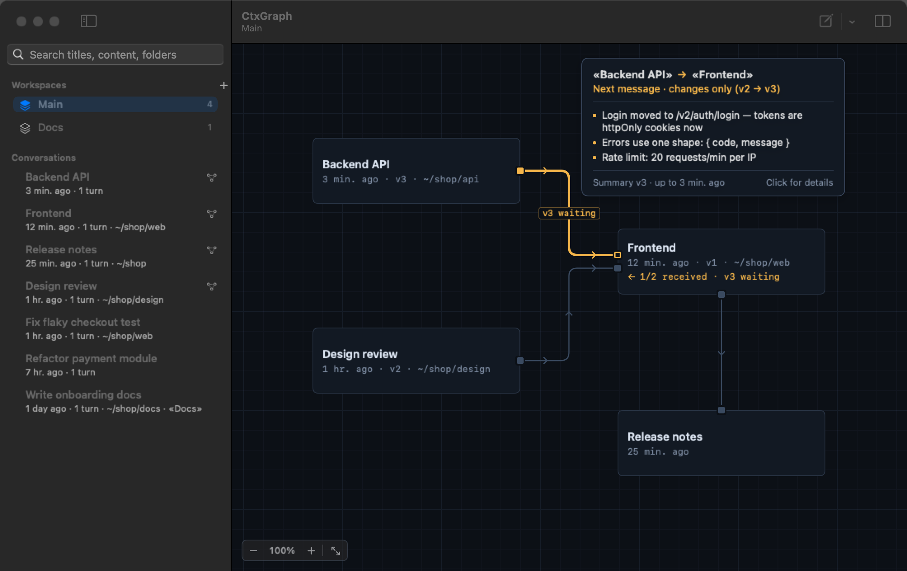

<p align="center"></p>

<h1 align="center">CtxGraph</h1>

<p align="center"><b>把 Claude Code 的对话用线连起来的 Mac 应用</b><br>
从 A 向 B 画一条箭头，之后你在 B 里发的每条消息都会带上 A 的最新摘要。</p>

<p align="center">macOS 14 及以上 · 免费开源（MIT）· 本地运行，无需服务器<br>
<a href="README.md">English</a> · <a href="README.ko.md">한국어</a> · <a href="README.ja.md">日本語</a> · 简体中文</p>

> 应用界面目前只有英文和韩文（macOS 语言为韩语时显示韩文，其他情况显示英文），暂无中文界面。

---

把工作拆到多个 Claude Code 对话里——一个做后端，一个做前端，一个做设计评审——结果总要花时间把另一个窗口里定下的事情再解释一遍。CtxGraph 把这些对话连成一张图：

- **A → B** —— 在 B 里发消息时，Claude 也会收到 A 的最新摘要（第一次是完整摘要，之后只有变化的部分）。
- **A ⇄ B** —— 双向共享上下文。
- 看一眼线就知道 B 是否已经知道 A 刚定下的事：B 端的连接点是实心的表示已是最新，黄色的线表示有新摘要在等待。

它是内置终端的原生 Mac 应用，可以在图旁边打开任意对话，接着工作。

## 工作原理

```
 对话 A ──(一轮结束)──▶ Haiku 摘要 v3 ──(你在 B 发下一条消息)──▶ 对话 B
     Stop 钩子：安排生成摘要          UserPromptSubmit 钩子：作为额外上下文注入
```

1. CtxGraph 会在 `~/.claude/settings.json` 中添加几个 [Claude Code 钩子（hooks）](https://docs.claude.com/en/docs/claude-code/hooks)（添加前会先备份原文件，也不会动你的其他钩子）。
2. **发送**上下文的对话结束一轮后，后台任务会等它安静 20 秒（且距上次摘要至少 2 分钟），再用 **Claude Haiku** 更新摘要——走的是你自己的 Claude Code 登录（`claude -p`），只合并新增的消息。
3. 在**接收**上下文的对话里发消息时，钩子会把还没收到的摘要作为额外上下文加进去：第一次是完整摘要，之后只有增量。聊天界面里什么都不会出现，只是 Claude 知道了。

不向任何地方发送的对话不会被摘要。也没有服务器：应用和钩子共用一个 SQLite 文件。

## 安装

**要求：** macOS 14 及以上、[Claude Code](https://claude.com/claude-code)、Python 3.9 及以上（macOS 开发者工具自带的 `python3` 就够了——如果没有，应用会引导你安装）。

**方式 1 —— 下载。** 从 [Releases](https://github.com/groothaha/ctx-graph/releases) 下载 `CtxGraph-<版本>.zip`，解压后把 `CtxGraph.app` 移到“应用程序”文件夹。
CtxGraph **没有经过 Apple 公证**（公证需要付费的开发者账号），所以第一次打开时 macOS 会阻止。打开 **系统设置 → 隐私与安全性**，向下滚动，点 **仍要打开**；或者运行：

```sh
xattr -dr com.apple.quarantine /Applications/CtxGraph.app
```

**方式 2 —— Homebrew。** 是同一个应用，首次打开也需要同样的步骤：

```sh
brew install --cask groothaha/tap/ctxgraph
```

**方式 3 —— 从源码构建**（不会出现 Gatekeeper 提示；需要 Xcode Command Line Tools，大约 1 分钟）：

```sh
git clone https://github.com/groothaha/ctx-graph && cd ctx-graph
./build.sh            # → ~/Applications/CtxGraph.app
```

`build.sh` 会先检查所需环境（macOS 14 及以上、Command Line Tools、Swift 5.9 及以上、Python、Claude Code），缺少 Command Line Tools 时会询问是否安装。只想检查可以运行 `./build.sh --check`。仍然构建失败时请看 [DEVELOPMENT.md 的 Building 一节](docs/DEVELOPMENT.md#building)（英文）。

## 首次运行



空白的图会带你完成三步：找到 `claude`，建议你 **Turn on context linking**（安装钩子——随时可以在 Settings → Claude Code 里关闭），然后从左侧边栏把两个对话拖到画布上。

## 使用方法



- **添加对话** —— 从侧边栏拖过来，或者右键点击画布空白处 → *Add Conversation Here*。
- **连接** —— 把卡片上的 ⊕ 拖到另一张卡片上（也可以从卡片右键拖动）。反方向再拖一次就是 ⇄。点击箭头可以改接任意一端、反转方向或删除。
- **看懂连线** —— 线上的折角符号（›）指向上下文流动的方向。灰色的线、接收端连接点为实心，表示*已是最新*；黄色的线、接收端连接点为空心，表示新摘要正在等待接收方的下一条消息。虚线表示摘要已排队或正在生成，红色表示失败。
- **速览** —— 鼠标悬停在箭头上，可以看到接下来要传过去的内容（或上一次传过去的内容）。
- **预览** —— 接收方对话的检查器里会显示它下一条消息实际会带上的完整文字。
- **继续工作** —— 双击卡片，在右侧终端里继续这个对话（`claude --resume`）。内置标签页、分屏（⌘D）和竖排标签列表，退出应用后终端仍在运行。
- **工作区** —— 把图和终端布局分成多套（⌘1…9）。同一个对话可以放在多个工作区里，连线也可以跨工作区。
- **在 Claude Code 里** —— 输入 `/ctx`（应用会安装这个技能）：`/ctx from <名称>` 拉取另一个对话的上下文，`/ctx to <名称>` 把这个对话的上下文发出去，`/ctx link <名称>` 双向共享。

更多内容见[指南](docs/GUIDE.md)（英文）——箭头状态、终端、工作区、模型和快捷键。

## 隐私与费用

- 一切都留在你的 Mac 上：对话记录从 `~/.claude/projects` 读取，图保存在 `~/Library/Application Support/CtxGraph/`。没有遥测，也不需要账号。
- 唯一发出去的是摘要请求，通过你自己的 Claude Code 登录发给 Anthropic——所以**会计入你的 Claude Code 用量**（在 Settings → Claude Code 里可以看到今天和本周跑了多少次摘要）。也可以把摘要模型换成 API 密钥（Anthropic、OpenRouter 或任何兼容 Anthropic 的接口）。
- 只有带出向箭头的对话才会被摘要，而且只处理新消息。
- 应用内终端里的 Claude Code 会照常询问权限。*Run Claude without permission prompts*（`--dangerously-skip-permissions`）需要你自己在 Settings → Terminal 里打开。

## 关闭

Settings → Claude Code → **Turn off (remove hooks)**，或运行 `python3 -I ~/Library/Application\ Support/CtxGraph/bin/ctxgraph.py uninstall-hooks`。只会移除 CtxGraph 的钩子，你的其他钩子和设置保持不变。要彻底删除，再删掉 `~/Library/Application Support/CtxGraph` 即可。

## 常见问题

**支持 Codex、Gemini CLI 或 Cursor 吗？** 不支持——CtxGraph 是为 Claude Code 做的（用到它的钩子、对话记录和 `--resume`）。OpenRouter 或其他兼容 Anthropic 的 API 上的模型可以用，因为它们是在 Claude Code 里运行的。

**为什么用钩子而不是 MCP 服务器？** 钩子会在每条消息时自动注入上下文；如果做成工具，就得由 Claude 决定要不要调用。

**会拖慢 Claude Code 吗？** 对不在图里的对话，钩子大约 45 毫秒就结束。摘要在一轮结束后于后台运行。

**支持 Windows / Linux 吗？** 目前不支持——这是一个 SwiftUI 的 Mac 应用。

## 文档

- [指南](docs/GUIDE.md) —— 应用的全部功能和快捷键（英文）
- [开发](docs/DEVELOPMENT.md) —— 架构、构建、测试、隔离测试环境、本地化、发布（英文）

## 许可证

MIT —— 见 [LICENSE](LICENSE)。包含 [SwiftTerm](https://github.com/migueldeicaza/SwiftTerm)（MIT）和 [D2Coding](https://github.com/naver/d2codingfont) 字体（SIL OFL 1.1）；见 [THIRD_PARTY_NOTICES.md](THIRD_PARTY_NOTICES.md)。
